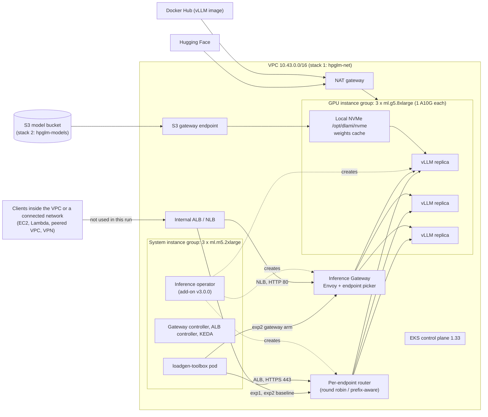

# Qwen3-0.6B rehearsal on SageMaker HyperPod: architecture, experiments and results

This is a small-model rehearsal of the three GLM-5.3 benchmarks in [README.md](README.md). It runs the same experiment arms with Qwen3-0.6B on `ml.g5.8xlarge` nodes, which were available on demand, before GPU time for GLM-5.3 on `ml.p5en.48xlarge`.

The goal was to check that the HyperPod inference features work end to end and that the load generators produce usable numbers. A 0.6B model processes prompts too quickly to show the gains a 750 GB model would, so treat the results as a functional check, not as GLM-5.3 predictions.

Run date: 19 November 2026, us-west-2.

## Summary

| Experiment | Compared | Result |
|---|---|---|
| 1. KV cache and prefix-aware routing | Round robin vs prefix-aware routing with the managed tiered KV cache | **Blocked.** Round robin ran. Every KV cache configuration fails to deploy because of an operator issue ([details](#1-kv-cache-arms-fail-to-deploy)). |
| 2. Inference Gateway under bursty traffic | Round robin vs the Inference Gateway | Gateway cut burst p99 end-to-end latency by 9.5% (37.10 s to 33.57 s) and p95 by 7.5%. |
| 3. Weights and image caching during scale-out | Caching off vs on | Caching cut time for a new replica to serve by 6.2% (95.8 s to 89.9 s). The image cache saving couldn't be measured ([why](#experiment-3-weights-and-image-caching-during-scale-out)). |

## Architecture



### Stacks and components

| Layer | What runs | Notes |
|---|---|---|
| Network (`01-network-eks.yaml`) | VPC with one public and three private subnets, NAT gateway, S3 gateway endpoint, EKS 1.33 control plane, OIDC provider | The third private subnet (`usw2-az3`, set with `ExtraPrivateSubnetAzId`) was added to find GPU capacity. |
| Storage (`02-model-storage.yaml`) | S3 model bucket | Holds `Qwen/Qwen3-0.6B` (1.5 GB) and `zai-org/GLM-5.3` (756 GB). Retained when the stack is deleted. |
| Cluster (`03-hyperpod-cluster.yaml`) | HyperPod cluster with a system group (3 x `ml.m5.2xlarge`) and a GPU group (3 x `ml.g5.8xlarge`), IAM roles, EKS add-ons | GPU group placed across three zones with `GpuSubnetIds`. Managed tiered storage on (20% of node memory). |
| Inference add-on | Inference operator, Inference Gateway controller, AWS Load Balancer Controller, KEDA | v3.0.0-eksbuild.1 (upgraded from v2.1.0 during the run). Controllers run on the system nodes. |
| Per endpoint (created by the operator) | Worker Deployment (vLLM plus a reverse-proxy and an OpenTelemetry sidecar), a router Deployment and service, an internal ALB, and weights-cache and image-cache DaemonSets | One `InferenceEndpointConfig` per experiment arm. |
| Gateway arm only | `InferenceGatewayConfig`, Envoy proxy behind an internal NLB, endpoint picker, `InferencePool` | Created from the arm's `inferenceGateway` section. |
| Load generation | `loadgen-toolbox` Deployment on a system node | Runs `loadgen/*.py` inside the VPC, so results don't depend on a laptop's network path. |

### Model serving settings

| Setting | Value |
|---|---|
| Model | `Qwen/Qwen3-0.6B`, BF16, Apache-2.0 |
| Container | `vllm/vllm-openai:v0.33.0` |
| vLLM arguments | `--max-model-len 40960 --reasoning-parser qwen3`, no tensor parallelism |
| Resources per replica | 1 GPU, 4 CPUs, 32 Gi memory |
| Requests | Chat completions with `chat_template_kwargs: {"enable_thinking": false}` |
| GPU node | 1 x A10G (24 GB), about 31.8 allocatable CPUs, about 115 GiB memory, 29 pods, 824 GB NVMe at `/opt/dlami/nvme`, 100 GB root volume |

### Request paths

| Arm | Address the load generators used | Protocol |
|---|---|---|
| Round robin, prefix-aware | `http://<endpoint>-<namespace>-routing-service.hyperpod-inference-system.svc:443` | Plain HTTP, despite the port number |
| Gateway | `http://envoy-hyperpod-inference-system-<gateway>-<hash>.hyperpod-inference-system.svc:80` | HTTP |
| Any arm through the internal ALB | `https://internal-k8s-hyperpod-...elb.amazonaws.com` | HTTPS with a self-signed certificate |

All load balancers the operator created were internal, reachable only from inside the VPC or networks connected to it, and none had authentication. The load generators bypassed them and called the in-cluster services directly, so the measurements include no load-balancer hop.

### Traffic path by experiment

In every experiment, requests start in the `loadgen-toolbox` pod on a system node and stay inside the cluster. None pass through the ALB or NLB.

**Experiment 1, round-robin arm (ran):**

1. `multiturn_coding.py` sends a chat request to the endpoint's router service (`qwen06-rr-glm53-routing-service`, port 443, plain HTTP).
2. The service forwards it to the endpoint's router pod. Kubernetes placed the router on one of the GPU nodes.
3. The router picks the next replica in turn.
4. The request reaches a worker pod on a GPU node. The pod has a reverse-proxy sidecar, but this run didn't check whether the router goes through it or calls vLLM on port 8000 directly.
5. vLLM computes or reuses the prefix in its own GPU KV cache and streams tokens back along the same path.

**Experiment 1, prefix-aware arm (planned; couldn't be deployed):** the same path, except that the router picks the replica that last saw the same prompt prefix. vLLM would also check LMCache: first the KV blocks in that node's CPU memory (L1), then HyperPod managed tiered storage (L2), which shares KV blocks across nodes.

**Experiment 2, round-robin arm:** the same path as experiment 1's round-robin arm.

**Experiment 2, gateway arm:**

1. `bursty_traffic.py` sends to the Envoy service (`envoy-hyperpod-inference-system-qwen06-gateway-…`, port 80).
2. An Envoy proxy pod receives it and asks the endpoint picker (`qwen06-gw-epp`, port 9002) which replica should take it. The picker scores replicas on live metrics such as queue depth and KV cache use. A body-based routing service (`qwen06-gateway-bbr`) reads the model name from the request.
3. Envoy forwards to the chosen worker pod, and vLLM streams back through Envoy.

The operator also created a router service for this arm (`qwen06-gw-routing-service`), but no load-test traffic went to it.

**Experiment 3, adding the replica:**

1. `scaleout_timer.py` runs `kubectl scale` on the worker Deployment, through the EKS API server.
2. The Deployment controller creates a pod, and the scheduler puts it on the spare GPU node.
3. The kubelet on that node gets the image and the weights:

   | | Caching off | Caching on |
   |---|---|---|
   | Image | Pulled from Docker Hub through the NAT gateway. In this run it was already on the node (0.5 s). | Already on the node: the image-cache DaemonSet pulled it to every GPU node when the arm was created. |
   | Weights | The init container prefetches them from S3, through the S3 gateway endpoint, into the pod. | Read from local NVMe (`/opt/dlami/nvme`). The cache download DaemonSet had copied them there from S3 when the arm was created. |

4. vLLM starts and loads the model, and the pod becomes Ready.
5. The script sends `Say OK.` straight to the new pod's IP on port 8000, bypassing the router and the gateway. The time of that first answer is the "time to serve" result.

**Common to all arms:**

- Each worker's OpenTelemetry sidecar collects vLLM metrics. The gateway's endpoint picker relies on them, and so do autoscaling and monitoring.
- The inference operator on a system node watches each `InferenceEndpointConfig` and creates or updates the router, gateway, workers, caches and load balancers through the EKS API.

## Experiment 1: KV cache and prefix-aware routing

**Question:** does the managed tiered KV cache with prefix-aware routing cut time to first token (TTFT) and cost per token, compared with round robin, when coding sessions resend the same repository context?

**Workload** (`multiturn_coding.py`): 8 coding sessions of 4 turns each, 4 sessions in flight, a 16,000-token repository context resent on every turn, 128 output tokens, 1 s between turns.

**Round-robin arm (`exp1-roundrobin`, 3 replicas):**

| Metric | Value |
|---|---|
| Requests / errors | 32 / 0 |
| TTFT, turn 1 (context never seen), p50 / p90 | 1.40 s / 1.86 s |
| TTFT, turns 2 to 4, p50 / p90 | 0.17 s / 1.46 s |
| TTFT p50 by turn (1 to 4) | 1.40 s, 1.39 s, 0.10 s, 0.17 s |
| End-to-end p50 / p99 | 2.47 s / 4.41 s |
| Throughput | 23,555 tokens/s |
| Cost per million tokens (3 nodes at $3.06/hr) | $0.108 total, $17.73 output |

Later turns are bimodal. A turn that reaches a replica already holding the context is fast, because vLLM's own prefix cache on that replica hits. A turn that reaches a different replica recomputes the context. Prefix-aware routing is designed to remove the slow cases.

**Prefix-aware arm (`exp1-prefixaware-tiered`): not run.** The operator couldn't create its worker Deployment (see [known issues](#1-kv-cache-arms-fail-to-deploy)).

## Experiment 2: Inference Gateway under bursty traffic

**Question:** with the same GPU capacity, does the gateway's GPU-aware endpoint selection cut tail latency during traffic spikes, compared with round robin?

**Workload** (`bursty_traffic.py`, open loop, Poisson arrivals, seed 7):

| Parameter | Value |
|---|---|
| Duration | 600 s |
| Base rate | 4 requests/s |
| Burst rate | 20 requests/s for 30 s, every 120 s |
| Prompt mix | 70% short (500 tokens), 30% long (16,000 tokens) |
| Output | 128 tokens |

Calibration runs set the burst rate. At 20 requests/s, queues build during each burst and drain between bursts. At 50 requests/s the replicas never recovered (burst p50 TTFT 39 s).

**Results (3 replicas in each arm, 0 errors in both):**

| Phase | Metric | Round robin | Gateway | Change |
|---|---|---|---|---|
| Burst | Requests | 2,391 | 2,418 | |
| Burst | TTFT p50 | 9.66 s | 9.03 s | −6.5% |
| Burst | TTFT p99 | 27.32 s | 25.24 s | −7.6% |
| Burst | End-to-end p50 | 14.05 s | 15.10 s | +7.5% |
| Burst | End-to-end p95 | 30.99 s | 28.68 s | −7.5% |
| Burst | **End-to-end p99** | **37.10 s** | **33.57 s** | **−9.5%** |
| Calm | End-to-end p50 | 0.86 s | 0.85 s | |
| Calm | End-to-end p95 | 26.30 s | 23.30 s | −11.4% |
| Calm | End-to-end p99 | 31.70 s | 30.18 s | −4.8% |
| All | Requests | 4,346 | 4,422 | |

The gateway cut tail latency (p95 and p99) in both phases, but the median end-to-end latency during bursts was slightly worse. Each arm ran once, and the request counts differ by 1.7% despite the same seed, so treat differences under about 5% as noise. With GLM-5.3, long prompts take much longer to process, so replicas get more unevenly loaded and the gateway has more to gain.

## Experiment 3: weights and image caching during scale-out

**Question:** does weights and image caching cut the time for a new replica to start serving?

**Method** (`scaleout_timer.py`): start with 2 replicas on 3 GPU nodes, add a third, and time the new pod from creation to its first answered request, sent directly to its pod IP. The script scales the worker Deployment, as an autoscaler would, because the operator ignores changes to the endpoint's `replicas` field.

| Phase | Caching off (`exp3-cache-off`) | Caching on (`exp3-cache-on`), run 1 | Caching on, run 2 |
|---|---|---|---|
| Init containers (image, weights prefetch) | 10.0 s | 7.0 s | 7.0 s |
| vLLM start-up and model load | 85.0 s | 79.0 s | 80.0 s |
| **Time to first answered request** | **95.8 s** | **89.9 s** | **89.9 s** |

Caching cut time to serve by 6.2% and the init phase by 30%. vLLM's own start-up takes most of the time, so the 1.5 GB weights barely matter. Caching should help far more with GLM-5.3's 756 GB.

**The image cache saving wasn't measured.** Earlier arms had already pulled the 9.7 GB vLLM image to every node. I removed its tag with `ctr images rm`, but containerd kept the layers and re-linked them in 0.5 s. A true cold pull needs a node that has never pulled the image, such as the first scale-out onto a fresh `p5en` node.

## Known issues found

### 1. KV cache arms fail to deploy

Any `kvCacheSpec` makes the operator build a worker Deployment that mounts a volume named `lmcache-config` without defining it, so Kubernetes rejects it:

```
Deployment.apps "qwen06-pa" is invalid: spec.template.spec.containers[0].volumeMounts[2].name: Not found: "lmcache-config"
```

The router is created normally; only the workers fail. The operator logs no permission or ConfigMap error first. Variants tried, all with the same error:

| Add-on | KV cache | Other changes |
|---|---|---|
| v2.1.0 | L1 + L2 (`tieredstorage`) | Weights and image cache on |
| v2.1.0 | L1 + L2 | Model cache removed |
| v3.0.0 | L1 + L2 | As written |
| v3.0.0 | L1 only | |
| v3.0.0 | L1 + L2, `mode: MultiProcess` | |
| v3.0.0 | L1 + L2, `cacheConfigFile` pointing at an LMCache config | |
| v3.0.0 | L1 + L2 | Prefetch off, no model cache |

This blocks experiment 1 for GLM-5.3 as well. It needs an operator fix or a documented workaround.

### 2. Rollouts deadlock when replicas use every GPU node

With image caching on, the operator adds a node-affinity preference once the cache is ready, which starts a new rollout. With 3 replicas on 3 single-GPU nodes, the default strategy (25% surge, 25% unavailable) can't proceed: the surge pod has no free GPU, and no old pod may be removed first. Workaround, applied right after each arm is created:

```bash
kubectl patch deploy <endpoint> -n <namespace> --type merge \
  -p '{"spec":{"strategy":{"rollingUpdate":{"maxSurge":0,"maxUnavailable":1}}}}'
```

The operator kept this setting on most arms but reset it once on the gateway arm, so check it.

### 3. Changing `spec.replicas` doesn't scale an existing endpoint

After an endpoint exists, raising `spec.replicas` on the `InferenceEndpointConfig` leaves the worker Deployment unchanged, although the operator logs "Successfully updated Deployment". Scaling the Deployment directly works, and the operator leaves it alone.

### 4. Deleting a gateway endpoint leaves the gateway behind

The `InferenceGatewayConfig`, its Envoy NLB and an ALB stay after the endpoint is deleted. Delete the gateway config separately (`kubectl delete inferencegatewayconfig <name> -n <namespace>`), or the load balancers block deleting stack 1.

### 5. Other observations

- The router service listens on port 443 with plain HTTP. The operator's ALB uses HTTPS with a self-signed certificate, which the load generators reject unless TLS verification is turned off.
- HyperPod managed tiered storage is accepted on `ml.g5.8xlarge`.
- `ThreadsPerCore: 1` didn't reduce the CPUs on `ml.g5.8xlarge`; all 32 vCPUs were allocatable.
- On-demand `ml.g5.8xlarge` and `ml.g5.12xlarge` capacity was unavailable in all three us-west-2 zones for about 8 hours. A background script retried hourly, and its fifth attempt succeeded.

## Reproducing the run

Deploy stacks 1 to 3 and the toolbox as in [README.md](README.md), then:

```bash
# GPU group across three zones (stack 1 deployed with ExtraPrivateSubnetAzId=usw2-az3)
aws cloudformation deploy --stack-name hpglm-hp \
  --template-file cloudformation/03-hyperpod-cluster.yaml \
  --parameter-overrides GpuInstanceType=ml.g5.8xlarge GpuInstanceCount=3 \
    GpuSubnetIds=<private-subnet-1>,<private-subnet-2>,<private-subnet-3> \
    InferenceAddonVersion=v3.0.0-eksbuild.1 \
  --capabilities CAPABILITY_IAM

# Model and variables
export HF_REPO=Qwen/Qwen3-0.6B MODEL_PREFIX=Qwen/Qwen3-0.6B INSTANCE_TYPE=ml.g5.8xlarge
export VLLM_IMAGE=vllm/vllm-openai:v0.33.0 NVME_HOST_PATH=/opt/dlami/nvme
envsubst < k8s/download-model-job.yaml | kubectl apply -f -

# One arm at a time; patch the rollout strategy right after applying (issue 2)
envsubst < k8s/endpoints/qwen3-0.6b/exp1-roundrobin.yaml | kubectl apply -f -
```

Load generator commands, run from the toolbox (`kubectl exec -it -n $NAMESPACE deploy/loadgen-toolbox -- bash`, then `cd /work`):

```bash
NOTHINK='{"chat_template_kwargs": {"enable_thinking": false}}'

# Experiment 1
python multiturn_coding.py --base-url http://qwen06-rr-glm53-routing-service.hyperpod-inference-system.svc:443 \
  --arm roundrobin --model qwen3-0.6b --sessions 8 --turns 4 --concurrency 4 \
  --context-tokens 16000 --max-tokens 128 --think-time 1 \
  --node-count 3 --node-hourly-usd 3.06 --extra-body "$NOTHINK"

# Experiment 2 (same command for each arm, changing --base-url and --arm)
python bursty_traffic.py --base-url <arm address> --arm <roundrobin|gateway> --model qwen3-0.6b \
  --duration 600 --base-rps 4 --burst-rps 20 --burst-every 120 --burst-length 30 \
  --max-tokens 128 --seed 7 --extra-body "$NOTHINK"

# Experiment 3
python scaleout_timer.py --endpoint qwen06-cold --namespace glm53 --label cache-off --model qwen3-0.6b --restore
python scaleout_timer.py --endpoint qwen06-warm --namespace glm53 --label cache-on --model qwen3-0.6b --restore
```

Each script writes a CSV and a `-summary.json` to `/work/results`.

## Cost

| Item | Amount |
|---|---|
| GPU nodes, 3 x `ml.g5.8xlarge` at $3.06/hr | 3.7 hours, about $34 |
| Rest of the cluster (system nodes, EKS with extended support for 1.33, NAT gateway) | about $2/hr while running |
| Failed capacity attempts | $0 (no instance launched) |

## What this means for the GLM-5.3 run

- Experiment 1 needs the `lmcache-config` issue fixed before it can run.
- Apply the rollout-strategy patch to every 3-replica arm on 3 nodes.
- Scale by Deployment in experiment 3, and run cache-off first on nodes that have never pulled the vLLM image.
- Delete each `InferenceGatewayConfig` after the gateway arm.
- `NVME_HOST_PATH=/opt/dlami/nvme` is confirmed on HyperPod GPU nodes.
