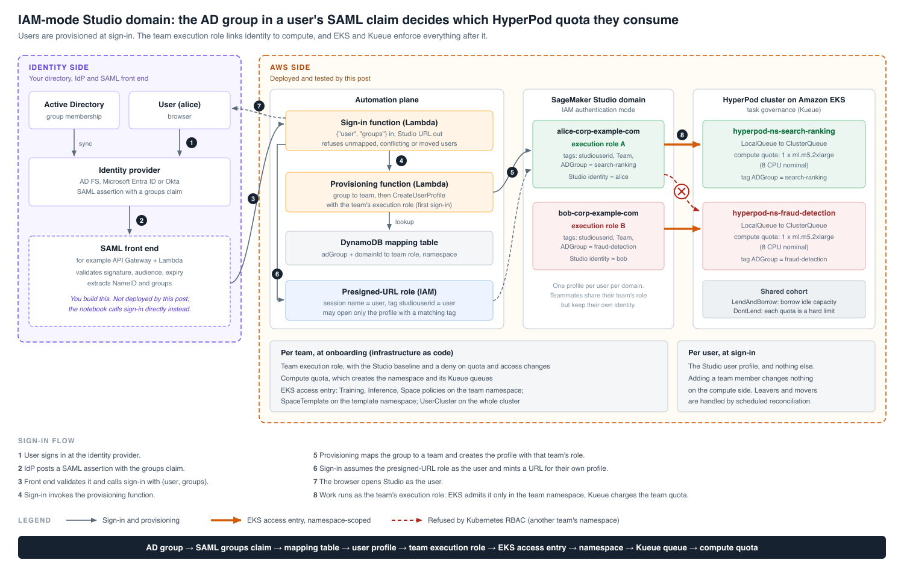

# Allocate SageMaker HyperPod compute quotas from Active Directory groups

Companion code for the two-part AWS blog series. A user's Active Directory group decides which Amazon SageMaker HyperPod compute quota their work consumes. Amazon EKS and Kueue enforce it on every request.

| Part | Studio domain authentication | Post | Notebook |
|---|---|---|---|
| 1 | IAM, users federate through a SAML identity provider | *link to be added on publication* | [`notebooks/part1-iam-mode.ipynb`](notebooks/part1-iam-mode.ipynb) |
| 2 | AWS IAM Identity Center | *coming soon* | *coming soon* |



## How it works

```
AD group → SAML groups claim → mapping table → user profile → team execution role
         → EKS access entry → namespace → Kueue queue → compute quota
```

Each team gets its own Studio execution role, compute quota and namespace-scoped EKS access entry. When a user signs in, a provisioning function looks up their groups in a DynamoDB mapping table and creates a Studio profile carrying their team's role. A sign-in function then creates the Studio URL under a session named for the user. Everything after the execution role is enforced by the cluster.

## Contents

| Path | What it is |
|---|---|
| `cloudformation/01-network-eks.yaml` | Stack 1: VPC with private subnets, NAT gateway, EKS control plane |
| `cloudformation/02-hyperpod-domain.yaml` | Stack 2: HyperPod cluster, EKS add-ons (Pod Identity, task governance, cert-manager, EBS CSI, Spaces), scheduler policy, Studio domain |
| `cloudformation/03-automation-plane.yaml` | Stack 3: mapping table, team execution roles, provisioning and sign-in functions, presigned-URL role |
| `notebooks/part1-iam-mode.ipynb` | Part 1 walkthrough: onboards two teams, signs users in from group claims, and proves attribution, cross-team denial, borrowing and hard limits |
| `tools/build_part1_notebook.py` | Regenerates the Part 1 notebook. Edit this rather than the notebook JSON |
| `images/` | Architecture diagrams, with SVG sources |

## Quick start (Part 1)

Prerequisites: AWS CLI v2, `kubectl`, `helm`, `git`, and Python 3.10 or later; `ml.m5.2xlarge for cluster usage` quota of at least 2 in your Region. Run every command from this directory.

```bash
export AWS_REGION=us-west-2
export ADMIN_ARN=arn:aws:iam::111122223333:role/YourAdminRole   # IAM role ARN, not assumed-role

# 1. Network and EKS
aws cloudformation deploy --template-file cloudformation/01-network-eks.yaml --stack-name hpq-net \
  --capabilities CAPABILITY_IAM --parameter-overrides ClusterAdminPrincipalArn="$ADMIN_ARN"
aws eks update-kubeconfig --name hpq-net-eks

# 2. HyperPod Helm chart (required before the HyperPod cluster)
git clone --depth 1 https://github.com/aws/sagemaker-hyperpod-cli.git /tmp/hyperpod-cli
helm dependencies update /tmp/hyperpod-cli/helm_chart/HyperPodHelmChart
helm install hyperpod-dependencies /tmp/hyperpod-cli/helm_chart/HyperPodHelmChart --namespace kube-system

# 3. HyperPod cluster, add-ons and Studio domain (25 to 30 minutes)
aws cloudformation deploy --template-file cloudformation/02-hyperpod-domain.yaml --stack-name hpq-iam \
  --capabilities CAPABILITY_IAM --parameter-overrides NetworkStackName=hpq-net AuthMode=IAM

# 4. Automation plane
HP_ARN=$(aws cloudformation describe-stacks --stack-name hpq-iam \
  --query "Stacks[0].Outputs[?OutputKey=='HyperPodClusterArn'].OutputValue" --output text)
DOMAIN_ID=$(aws cloudformation describe-stacks --stack-name hpq-iam \
  --query "Stacks[0].Outputs[?OutputKey=='StudioDomainId'].OutputValue" --output text)
aws cloudformation deploy --template-file cloudformation/03-automation-plane.yaml --stack-name hpq-automation \
  --capabilities CAPABILITY_NAMED_IAM \
  --parameter-overrides EksClusterName=hpq-net-eks HyperPodClusterArn="$HP_ARN" \
      StudioDomainId="$DOMAIN_ID" ValidationPrincipalArn="$ADMIN_ARN"

# 5. Run the notebook
python3 -m venv .venv && .venv/bin/pip install jupyter boto3
.venv/bin/jupyter lab notebooks/part1-iam-mode.ipynb
```

The notebook reads all configuration from the stacks named above. Run it top to bottom.

## Clean up

1. In the notebook, set `RUN_CLEANUP = True` in the last section and run it. It removes the test jobs and users, both compute quotas and both access entries.
2. Delete the stacks in reverse order: `hpq-automation`, then `hpq-iam`, then `hpq-net`.

`ValidationPrincipalArn` lets your admin role assume the team roles so the notebook can act as a team member. It's for testing only. Remove it, or delete the stack, when you finish.

## Cost

The stacks run an EKS control plane, a NAT gateway and two `ml.m5.2xlarge` HyperPod instances until you delete them. Stack 1 prints an `EstimatedHourlyCost` output. Check current pricing for your Region.

## License

MIT-0. See the repository [LICENSE](../../LICENSE).
