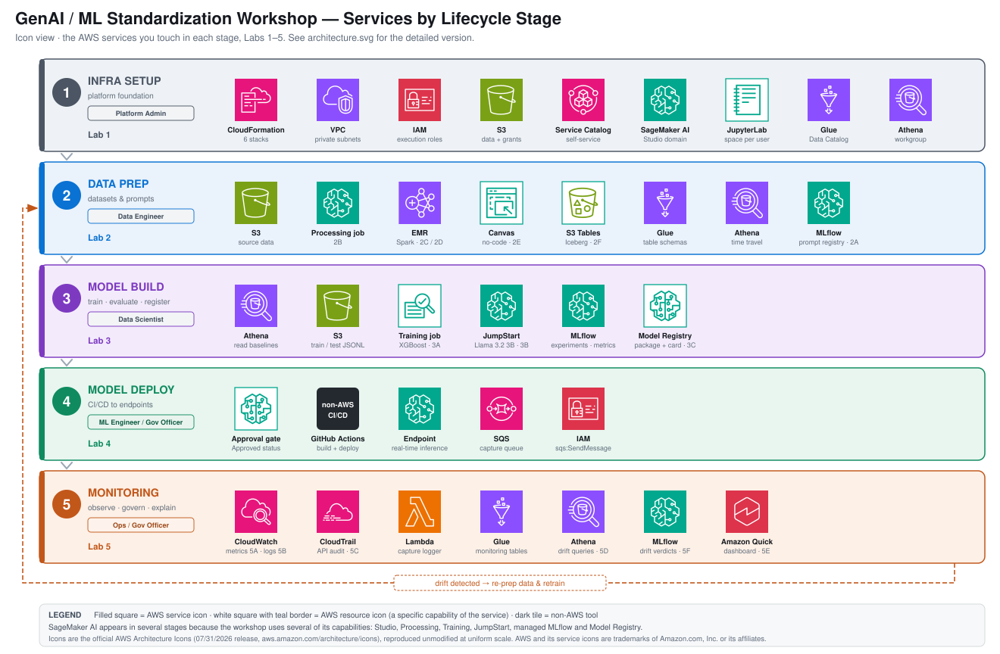
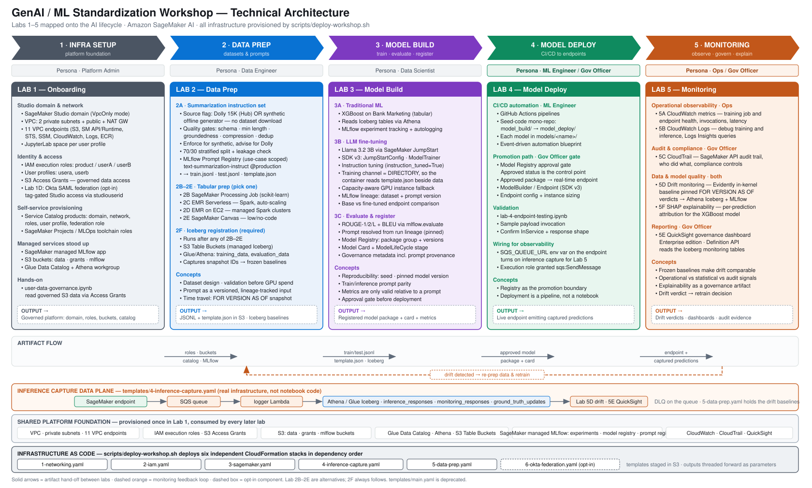

# GenAI & ML Standardization

A hands-on workshop and reference implementation for standardizing the end-to-end machine learning lifecycle on AWS. It combines guided lab notebooks with production-ready MLOps seed code and infrastructure templates, covering both **traditional ML** (XGBoost classification) and **generative AI** (foundation-model fine-tuning) workflows.

The workshop is built on **Amazon SageMaker AI (SMAI)** — the core ML service for training, tuning, JumpStart foundation models, the Model Registry, and real-time endpoints.

The labs are organized around the personas who operate an ML platform — **platform admins**, **data engineers**, **data scientists**, and **ML/Ops engineers** — walking each role through their part of the lifecycle, from platform setup and data preparation to model build, automated deployment, and monitoring.

The material emphasizes **governance at scale**: experiment tracking, model lineage, model registry approval workflows, and automated CI/CD from project creation through production deployment.

## Technical Architecture

The five labs map one-to-one onto the stages of the AI lifecycle. Two views of the same architecture are available — start with whichever suits you.

### Services at a glance

One band per lifecycle stage, showing only the AWS services you touch there. Good for orienting yourself before a lab, or for a quick "what am I actually using?" answer.



SageMaker AI shows up in several bands because the workshop uses several of its capabilities — Studio, Processing, Training, JumpStart, managed MLflow, and Model Registry. The only non-AWS tool is GitHub Actions in Lab 4, marked with a dark tile.

### Detailed view

Each column is a lab; the bands underneath are shared — the platform foundation is provisioned once and consumed by every later lab.



| Lifecycle stage | Lab | Persona | Key artifact it produces |
|---|---|---|---|
| Infra setup | Lab 1 | Platform Admin | Governed platform: domain, roles, buckets, catalog |
| Data prep | Lab 2 | Data Engineer | `train.jsonl` / `test.jsonl` / `template.json` + Iceberg baselines |
| Model build | Lab 3 | Data Scientist | Registered model package + model card + metrics |
| Model deploy | Lab 4 | ML Engineer / Gov Officer | Live endpoint emitting captured predictions |
| Monitoring | Lab 5 | Ops / Gov Officer | Drift verdicts, dashboards, audit evidence |

Three things in the diagram are worth calling out, because they are easy to assume wrongly:

- **The lifecycle is a loop, not a pipeline.** The dashed orange path from Lab 5 back to Lab 2 is the point of drift monitoring — a drift verdict is a retraining decision.
- **Inference capture is real infrastructure, not notebook code.** `endpoint → SQS → logger Lambda → Iceberg tables` is created by `templates/4-inference-capture.yaml`. Lab 5D's notebook writes drift *verdicts*; the captured predictions arrive through that pipeline.
- **Drift is computed in-kernel.** Lab 5D runs Evidently in the notebook and `INSERT`s results into Athena. There is no scheduled drift Lambda, EventBridge rule, SNS topic, or CloudWatch alarm anywhere in this repo.

## What's Inside

The repository is organized as a sequence of persona-oriented labs that follow the ML platform lifecycle — from platform setup, to data prep, model build, deployment automation, and monitoring — plus reusable seed code and infrastructure assets.

| Lab | Persona | Purpose |
|-----|---------|---------|
| `lab0-setup/` | All | **Run first.** Installs the shared kernel dependencies and writes the repo-root `.env` every lab reads. |
| `lab1-onboarding/` | Platform Admin | Set up the platform infrastructure and onboard users with governed S3 access. |
| `lab2-data-prep/` | Data Engineer | Prepare data two ways: a summarization instruction dataset for fine-tuning (2A), and tabular prep via processing jobs, EMR, or Canvas (2B–2E) followed by Iceberg registration (2F). |
| `lab3-model-build/` | Data Scientist | Experiment with and build both traditional ML (XGBoost) and LLM (Llama 3.2 3B fine-tuning) models, then evaluate and register them. |
| `lab4-model-deploy/` | ML Engineer / Gov Officer | Automate build and deployment via CI/CD, gated on Model Registry approval. |
| `lab5-monitoring/` | Ops / Gov Officer | Monitor operational metrics and logs, audit API activity, detect drift, explain predictions, and report via QuickSight. |
| `seed-code/` | — | Production-ready MLOps seed repositories (model build + model deploy). |
| `templates/` | — | CloudFormation templates — six stacks deployed by `scripts/deploy-workshop.sh`. |
| `scripts/` | — | Deploy, teardown, and cleanup utilities. |
| `workshop_common/` | — | Shared `.env` loader and dataset schema, re-exported by `workshop_env.py`. |
| `images/` | — | Architecture diagram and lab screenshots. |

### Lab Details

**Lab 0 – Setup** (`lab0-setup/`) · _All personas_
- `setup.ipynb` – Run **once per JupyterLab space, before any other lab**. Installs the shared kernel dependencies from the root `requirements.txt`, then discovers the AWS environment once (region, account, project name, data bucket, execution role, user profile, MLflow tracking URI, Iceberg identifiers) and writes a single repo-root `.env`. Every lab reads that file via `workshop_env.load_workshop_env()`; no lab discovers or hardcodes these values itself.

**Lab 1 – Onboarding** (`lab1-onboarding/`) · _Platform Admin_
Setting up the **SMAI** platform infrastructure — SageMaker Studio domain (VpcOnly), VPC with private subnets and VPC endpoints, IAM execution roles, user profiles, S3 Access Grants, and the managed MLflow app — then onboarding users with governed access to data in S3.
- `service-catalog/` – Service Catalog products for self-service provisioning of the domain, networking, roles, user profiles, and the federation role.
- Lab 1D (optional) – Okta SAML federation via `templates/6-okta-federation.yaml`: a SAML identity provider, a federation role, and tag-gated Studio access keyed on `studiouserid`.

**Lab 2 – Data Prep** (`lab2-data-prep/`) · _Data Engineer_
Two independent tracks. **2A** builds the instruction dataset for the LLM fine-tuning lab; **2B–2E** are alternative tools for the tabular dataset, and **2F** is the shared step every tabular path finishes with.
- `lab-2a-fine-tuning-data-prep.ipynb` – Summarization instruction dataset. One flag, `DATA_SOURCE`, chooses between downloading **Databricks Dolly 15K** and generating an equivalent corpus offline with `synthetic_corpus.py`. Both paths then run the same quality gates (schema, minimum length, groundedness, compression ratio, exact and near-duplicate detection), a 70/30 stratified split with a leakage check, and registration of the prompt in the **MLflow Prompt Registry**. Produces `train.jsonl`, `test.jsonl`, and `template.json`.
- `synthetic_corpus.py` – Offline, seeded corpus generator. Template-grounded: each record is rendered from a structured fact dictionary, so a summary cannot cite a fact its context omits.
- `lab-2b-traditional-ml-data-prep-processing-job.ipynb` – SageMaker Processing Job (scikit-learn container).
- `lab-2c-emr-serverless-data-prep.ipynb` – EMR Serverless (Spark).
- `lab-2d-emr-on-ec2-data-prep.ipynb` – EMR on EC2 (Spark).
- Lab 2E – SageMaker Canvas, low-code/no-code (console-based, no notebook).
- `lab-2f-iceberg-registration.ipynb` – **Required after any of 2B–2E.** Registers the processed CSVs into S3 Table Buckets and Glue/Athena Iceberg tables, and captures the snapshot IDs that Labs 3 and 5 pin as frozen baselines.
- `user-data-governance.ipynb` – Governed S3 data access patterns via S3 Access Grants.

**Lab 3 – Model Build** (`lab3-model-build/`) · _Data Scientist_
Using the **SMAI** platform tools — managed training, JumpStart, MLflow, and the Model Registry — to build, evaluate, and register both model types.
- `lab-3a_traditional_ml_experimenation.ipynb` – Traditional ML. Trains an XGBoost binary classifier on the UCI Bank Marketing dataset to predict term-deposit subscriptions, reading the Iceberg tables through Athena, with MLflow experiment tracking.
- `lab-3b-fine-tuning.ipynb` – Fine-tunes **Llama 3.2 3B** for summarization via SageMaker JumpStart and SDK v3 (`JumpStartConfig`, `ModelTrainer`). Tracks dataset and prompt-version lineage in MLflow, and compares the base and fine-tuned endpoints side by side.
- `lab-3c-model-evaluation-registration.ipynb` – Scores both models with ROUGE and BLEU through `mlflow.evaluate`, registers versions in the **Model Registry**, and attaches a Model Card plus governance metadata including the prompt version the metrics were produced with.
- `metrics.py` – Shared evaluation metric helpers.

**Lab 4 – Model Deploy** (`lab4-model-deploy/`) · _ML Engineer / Gov Officer_
Automating build and deployment onto **SMAI** endpoints with GitHub Actions, where the Model Registry **approval status is the control point** between the two personas: the ML Engineer owns the pipeline, the Gov Officer decides what passes through it. The automation blueprint lives in `seed-code/` (see below).
- `lab-4-endpoint-testing.ipynb` – Validates an `InService` endpoint with sample payloads.
- Deploying with the `SQS_QUEUE_URL` environment variable set is what turns on inference capture for Lab 5.

**Lab 5 – Monitoring** (`lab5-monitoring/`) · _Ops / Gov Officer_
Four kinds of signal, deliberately separated: operational health, audit trail, statistical drift, and per-prediction explainability.
- `lab5a-cloudwatch-metrics-monitoring.ipynb` – CloudWatch metrics for training jobs and endpoints (invocations, latency, errors).
- `lab5b-cloudwatch-logs-monitoring.ipynb` – CloudWatch Logs and Logs Insights for debugging training and inference.
- `lab5c-cloudtrail-monitoring.ipynb` – CloudTrail audit of SageMaker API activity for governance and compliance.
- `lab5d-inference-monitoring.ipynb` – Drift monitoring. Evidently runs **in the kernel**, comparing live predictions against the Lab 2F baselines pinned with `FOR VERSION AS OF`; verdicts are written to Athena Iceberg and logged to MLflow.
- `lab5e-governance-dashboard.ipynb` – QuickSight governance dashboard built with the Definition API over the Iceberg monitoring tables. Requires QuickSight **Enterprise** — see the prerequisites below.
- `lab5f_shap_explainability.ipynb` – SHAP per-prediction attribution for the deployed XGBoost model.
- `INFRASTRUCTURE.md` – What creates each resource Lab 5 depends on.

## Seed Code (MLOps Automation)

`seed-code/classification/` contains the MLOps automation blueprint — an event-driven, GitHub-Actions-driven architecture that connects model build to production deployment on **SMAI**.

- **`model_build/`** — SageMaker Pipeline definitions (preprocessing, XGBoost training, evaluation, registration) orchestrated via GitHub Actions. See `seed-code/classification/model_build/README.md` for full setup.
- **`model-build-repo.zip` / `model-deploy-repo.zip`** — Packaged seed repositories.
- **`model_deploy`** (in the deploy zip) — AWS CDK stack that retrieves the approved model from the registry and provisions/updates a SageMaker endpoint with validation and rollback.

### End-to-end automated flow

1. Deploy the supporting AWS infrastructure (EventBridge rules, Step Functions, Lambda) and configure the build and deploy repositories with seed code.
2. Code pushes trigger the GitHub Actions build pipeline.
3. The SageMaker pipeline runs preprocessing → training → evaluation.
4. Experiment tracking captures metrics and lineage (when a tracking server is configured).
5. The trained model is registered in the SMAI Model Registry as `PendingManualApproval`.
6. A reviewer approves the model, flipping its status to `Approved`.
7. The approval event triggers the GitHub Actions deployment workflow.
8. CDK deploys/updates the SageMaker endpoint.
9. The endpoint serves real-time predictions with full traceability.

## Prerequisites

- An AWS account with permissions for Amazon SageMaker, S3, AWS Glue, Athena, IAM, EMR, and CloudFormation.
- Access to **Amazon SageMaker AI (SMAI)**.
- **AWS CLI v2** — the deploy script stages templates in S3 and passes stack parameters as a JSON file, both of which need v2.
- **Python 3.12** to match the Studio kernel the labs are built against. The labs normally run on the Studio kernel; for a local kernel, create a venv and install `requirements.txt`.
- For Lab 5E only: a QuickSight **Enterprise** subscription — see the prerequisites section below.
- For the seed-code CI/CD flow: a GitHub organization with OIDC-based access to AWS.

## Getting Started

### 1. Deploy Infrastructure

The platform infrastructure is six independent CloudFormation stacks, deployed in dependency order by `scripts/deploy-workshop.sh`. Each can be updated, retried, or inspected on its own.

**Stack structure:**

| Template | Stack name | Purpose |
|----------|-----------|---------|
| `templates/1-networking.yaml` | `<project>-networking` | VPC, subnets, NAT Gateway, VPC endpoints, security groups |
| `templates/2-iam.yaml` | `<project>-iam` | IAM roles and policies for SageMaker, Lambda, MLflow, Access Grants, QuickSight |
| `templates/3-sagemaker.yaml` | `<project>-sagemaker` | SageMaker domain, user profiles, MLflow, S3 buckets, Glue catalog, Lambdas |
| `templates/4-inference-capture.yaml` | `<project>-inference-capture` | Inference-capture plane: SQS queue + logger Lambda, and the `inference_responses` / `monitoring_responses` / `ground_truth_updates` Iceberg tables in the `bank_marketing` database (Labs 5D/5E) |
| `templates/5-data-prep.yaml` | `<project>-data-prep` | EMR Serverless application and EMR on EC2 roles (Labs 2C/2D) |
| `templates/6-okta-federation.yaml` | `<project>-okta-federation` | Okta SAML provider, federation role, tag-gated Studio access (Lab 1D). Opt-in |
| `templates/main.yaml` | — | **Deprecated.** The old parent stack. Not deployed; kept only so an existing parent stack can still be deleted with the template that created it |

**Deployment is managed exclusively through the deploy script.** It runs as-is in AWS CloudShell, and it does several things raw `aws cloudformation` calls would not:

- deploys the stacks in dependency order and waits for each
- threads outputs forward as parameters — the SageMaker stack's data bucket and the IAM stack's execution-role names become parameters of the later stacks
- stages templates in S3, which is **required**, not an optimization: `aws cloudformation deploy` caps inline templates at 51,200 bytes and `2-iam.yaml` is ~87 KB. The script ensures a staging bucket (`<PROJECT_NAME>-cfn-<account>-<region>` by default) and passes `--s3-bucket`, so the CLI uploads each template and keys the object by its own content hash
- resolves the account-global Service Catalog role collision (`CREATE_SC_ROLES=auto`)
- prepares Lake Formation's `IAM_ALLOWED_PRINCIPALS` default so the Iceberg tables can be created
- detects QuickSight's real identity region when the default is wrong, instead of reporting a subscribed account as unsubscribed
- refuses to run if a legacy `main.yaml` parent stack is still present, rather than failing halfway through on `AlreadyExists`

```bash
./scripts/deploy-workshop.sh
```

Deployment takes **20–40 minutes**, most of it the SageMaker domain and the MLflow tracking server. The script prints the aggregated outputs when it finishes.

All configuration is environment variables, documented in full in the script's header comment:

```bash
PROJECT_NAME=my-workshop AWS_REGION=us-west-2 SEED_CODE_TYPE=classification \
  ./scripts/deploy-workshop.sh
```

| Variable | Default | Effect |
|----------|---------|--------|
| `PROJECT_NAME` | `bank-marketing-prediction` | Names all resources; lowercase letters, digits, hyphens only |
| `STACK_PREFIX` | `<PROJECT_NAME>` | Prefix for the six stack names |
| `TEMPLATE_BUCKET` | `<PROJECT_NAME>-cfn-<account>-<region>` | S3 bucket for staging templates; created if absent |
| `QUICKSIGHT_IDENTITY_REGION` | `us-east-1` | Region QuickSight was activated in. Auto-detected if the default is wrong; set it explicitly to skip detection, and match it in Lab 5E's config |
| `ONLY_STACKS` | *(all)* | Deploy a subset, e.g. `ONLY_STACKS=iam`. Prerequisite stacks must already exist |
| `SEED_CODE_TYPE` | `classification` | `classification` or `llm-fine-tuning` |
| `VPC_CIDR` | `10.1.0.0/16` | VPC CIDR block |
| `PRIVATE_SUBNET_CIDR` | `10.1.1.0/24` | Private subnet 1 |
| `PRIVATE_SUBNET2_CIDR` | `10.1.2.0/24` | Private subnet 2 |
| `PUBLIC_SUBNET_CIDR` | `10.1.3.0/24` | Public subnet (NAT Gateway) |
| `JUPYTERLAB_APP_INSTANCE` | `ml.m5.2xlarge` | Instance type for JupyterLab |
| `USER_A_PROFILE_NAME` | `userA` | Name for first user profile |
| `USER_B_PROFILE_NAME` | `userB` | Name for second user profile |
| `EMR_RELEASE_LABEL` | `emr-7.5.0` | EMR release for the Lab 2 data-prep stack |
| `CREATE_SC_ROLES` | `auto` | Create the SageMaker Projects / Service Catalog roles. Names are account-global, so only one stack per account may own them; `auto` detects existing roles and reuses them |
| `ENABLE_OKTA_FEDERATION` | `false` | Deploy the Lab 1D Okta stack. Requires `OKTA_METADATA_FILE` |
| `OKTA_METADATA_FILE` | — | Path to the SAML metadata XML from your Okta tenant (Sign On tab → View IdP metadata) |
| `SUBSCRIBE_QUICKSIGHT` | `false` | Subscribe the account to QuickSight — billable and permanent. See below |
| `TEARDOWN` | `false` | Delete the six stacks in reverse order |

**Monitor deployment:** the script waits and reports, so this is only for a second terminal.

```bash
aws cloudformation describe-stacks \
  --query "Stacks[?starts_with(StackName, '<YOUR_PROJECT_NAME>-')].{Name:StackName,Status:StackStatus}" \
  --output table --region <REGION>
```

**Updating one stack.** Because the stacks are independent, a change to one template only touches that stack:

```bash
ONLY_STACKS=iam ./scripts/deploy-workshop.sh
```

**Teardown.** Use the teardown script — it deletes the stacks in reverse order, and first clears the two things that block deletion (running Studio apps, and objects in the grants/data/mlflow buckets). If the networking stack delete hits the classic VpcOnly blocker, it removes the domain's orphaned EFS mount targets and NFS security groups and retries.

```bash
scripts/teardown-workshop.sh          # destructive; prompts for confirmation
TEARDOWN=true ./scripts/deploy-workshop.sh   # stacks only, no bucket cleanup
```

> **Migrating from the parent-stack layout.** There is no in-place migration. Resources in a legacy `main.yaml` deployment are owned by its nested stacks, so a standalone deploy collides on every fixed-name resource (IAM roles, data bucket, SageMaker domain, the `bank_marketing` Glue database). Run `scripts/teardown-workshop.sh` first — it **destroys the data bucket and its contents**, so export anything you need. The deploy script detects a live parent stack and stops before touching anything.

### QuickSight prerequisites (one-time per account)

Only **Lab 5E** (`lab5-monitoring/lab5e-governance-dashboard.ipynb`) needs QuickSight. Every other lab runs without it. There is no CloudFormation resource for a QuickSight subscription, so it is a separate, opt-in step — and it has two halves either way:

1. subscribe the account to **Enterprise** edition (billable, one-time, account-global);
2. deploy the stack with `AttachQuickSightServiceRolePolicy=true` so the data-access policies land on `aws-quicksight-service-role-v0`.

The ordering is not optional: an IAM policy resource fails outright if the role it targets does not exist, and that role is created by the subscription. That is why `AttachQuickSightServiceRolePolicy` defaults to `false` — a stack deployed before the subscription would otherwise roll back entirely. And skipping half 2 is the usual cause of a dashboard that publishes but whose panels all fail to load, because QuickSight reads Athena and S3 as its own service role, *not* as the notebook's execution role.

**The default path is the console**, during Lab 5E. The workshop docs
(`model-governance-at-scale-with-sagemaker-ai`, `content/lab/lab-5/lab-5e/`) walk it with
screenshots, and are the canonical version; the summary here is for anyone working from this
repo alone.

*Half 1 — subscribe.* Search the console for `quick`: you'll get two entries, **Amazon Quick**
(the suite the BI product now lives in) and **QuickSight** (the classic entry). Either works. On
the form, set a globally unique account name and a notification email, and leave
**Authentication method** on its default (*Password-based or Single-Sign On*, the equivalent of
`IAM_AND_QUICKSIGHT`) and **Encryption** on the AWS-managed key. The form's **Default region** is
where QuickSight stores its own data — *not* the identity region. It has no edition selector, so
verify afterwards:

```bash
ACCOUNT_ID="$(aws sts get-caller-identity --query Account --output text)"

aws quicksight describe-account-settings --aws-account-id "${ACCOUNT_ID}" \
  --region us-east-1 --query 'AccountSettings.Edition' --output text
```

*Half 2 — grant the service role access.* Now that `aws-quicksight-service-role-v0` exists, re-run
the deploy limited to the IAM stack. The script detects the service role and sets
`AttachQuickSightServiceRolePolicy=true` itself, so there is no parameter to pass:

```bash
ONLY_STACKS=iam ./scripts/deploy-workshop.sh
```

That touches only `<project>-iam`, so it is minutes rather than the 20-40 of a full deploy — which
is the practical benefit of the stacks being independent. A plain `./scripts/deploy-workshop.sh`
reaches the same end state and is safe to re-run, but it walks all six stacks.

Where you cannot update the stack at all, attach the two `PolicyDocument` blocks from `templates/2-iam.yaml`
directly with `aws iam put-role-policy`, using the project-scoped names
`${ProjectName}-QuickSightS3DataLakeAccess` and `${ProjectName}-QuickSightAthenaAccess` — these are
project-scoped so multiple projects can share the account-global QuickSight service role, and
`create_governance_dashboard.py` matches them by name (via `config.QUICKSIGHT_S3_POLICY_NAME` /
`QUICKSIGHT_ATHENA_POLICY_NAME`).

**Automating both halves instead.** For provisioning accounts in bulk rather than teaching from
them, the deploy script folds the whole thing into one run:

```bash
SUBSCRIBE_QUICKSIGHT=true QUICKSIGHT_NOTIFICATION_EMAIL=you@example.com \
  ./scripts/deploy-workshop.sh
```

Subscribes, waits for provisioning, confirms the service role, then deploys with the parameter
set. Already-subscribed accounts are detected and left alone. The flag defaults to `false`
because the subscription is billable and permanent, and should not be a side effect of a deploy
nobody read.

| Variable | Default | Notes |
|---|---|---|
| `SUBSCRIBE_QUICKSIGHT` | `false` | **Billable.** Creates the subscription |
| `QUICKSIGHT_NOTIFICATION_EMAIL` | — | Required when subscribing |
| `QUICKSIGHT_IDENTITY_REGION` | `us-east-1` | One per account, **permanent**. Must match `QUICKSIGHT_IDENTITY_REGION` in `.env` for Lab 5E |
| `QUICKSIGHT_EDITION` | `ENTERPRISE` | Lab 5E uses the Definition API, which requires Enterprise |
| `QUICKSIGHT_ACCOUNT_NAME` | `<PROJECT_NAME>-<account>` | **Permanent**; must be globally unique |
| `VERIFY_QUICKSIGHT_IAM` | `true` | Post-deploy check that the execution roles carry the Lab 5E actions |

**Why the edition needs verifying.** The sign-up form asks only for an account name, notification email, default data region, authentication method, and encryption key — nothing about editions — so a console signup gives you no way to tell which one you got. An account that landed on Standard upgrades from *Manage QuickSight → Account settings*; the downgrade is not supported.

**To open the dashboard in the QuickSight UI yourself** (the notebook does not need this): create a QuickSight **Author** or **Admin** user for your identity under *Manage QuickSight → Manage users*.

**Troubleshooting:**

| Symptom | Cause |
|---|---|
| Notebook reports "QuickSight not subscribed" | No subscription, or the caller lacks `quicksight:DescribeAccountSettings` — the notebook cannot tell these apart and says so |
| Dashboard created, panels show an error | QuickSight's service role has no access to the data bucket or Athena — redeploy with `AttachQuickSightServiceRolePolicy=true` |
| `AccessDeniedException` partway through the build | The execution role has some QuickSight permissions but not all — apply the `QuickSightGovernanceDashboard` statement from `templates/2-iam.yaml` |
| Subscription call fails with an account-name or region error | The account is already subscribed in a different region (set `QUICKSIGHT_IDENTITY_REGION`), or the name is taken (set `QUICKSIGHT_ACCOUNT_NAME`) |

### 2. Run Lab 0 Setup (once per JupyterLab space)

Open `lab0-setup/setup.ipynb` in SageMaker AI Studio and run it end to end **before any other lab**. It installs the shared kernel dependencies from `requirements.txt` and writes the repo-root `.env` that every lab reads.

Skipping this is the most common cause of a lab failing on its first cell: without `.env`, labs cannot resolve the project name, data bucket, execution role, user profile, or MLflow tracking URI.

> Individual labs contain no `pip install` cells by design — `requirements.txt` is the single source of truth for packages. Add dependencies there, not in a notebook.

### 3. Work Through the Labs

Open the notebooks under `lab1-onboarding/` through `lab5-monitoring/` and follow the instructions in each. Order matters in two places:

- **Lab 2:** pick **one** of 2B–2E for the tabular dataset, then always run **2F** to register the result into Iceberg. Lab 2A is independent and feeds Lab 3B.
- **Lab 3:** 3B before 3C — 3C evaluates the model 3B produced and reads the prompt version 3B pinned to its MLflow run.

### 4. Run the MLOps Seed Code (Optional)

Follow `seed-code/classification/model_build/README.md` to configure GitHub secrets/variables and run the SageMaker pipeline locally or via GitHub Actions.

### Run the build pipeline locally

```bash
cd seed-code/classification/model_build
python3 -m venv .venv
source .venv/bin/activate
pip install -r requirements.txt

python ./ml_pipelines/run_pipeline.py \
  --module-name training.pipeline \
  --role-arn <SAGEMAKER_PIPELINE_ROLE_ARN> \
  --tags '[{"Key":"sagemaker:project-name","Value":"<PROJECT_NAME>"},{"Key":"sagemaker:project-id","Value":"<PROJECT_ID>"}]' \
  --kwargs '{"region":"<REGION>","role":"<ROLE_ARN>","default_bucket":"<BUCKET>","pipeline_name":"local-test-pipeline","model_package_group_name":"<MODEL_GROUP>","glue_database_name":"<GLUE_DB>","glue_table_name":"<GLUE_TABLE>"}'
```

## Datasets

- **Bank Marketing Dataset** (UCI Machine Learning Repository) — the traditional ML classification labs (2B–2E, 3A, 5D, 5F).
- **Databricks Dolly 15K**, filtered to its summarization category — the default source for the Llama 3.2 fine-tuning labs (2A, 3B, 3C).
- **Synthetic summarization corpus** — generated offline by `lab2-data-prep/synthetic_corpus.py` as an alternative to Dolly. Set `DATA_SOURCE = "synthetic"` in Lab 2A. Useful when the Hugging Face Hub is unreachable from the Studio VPC, when dataset licensing or PII review is a blocker, or to teach dataset design rather than dataset acquisition.

## Clean Up

To avoid ongoing charges after completing the labs, use the teardown script. It deletes the six stacks in reverse dependency order and first clears the two things that otherwise block deletion — running Studio apps, and objects in the grants/data/mlflow buckets:

```bash
scripts/teardown-workshop.sh          # destructive; prompts for confirmation
```

If the networking stack delete hits the classic VpcOnly blocker, it removes the SageMaker domain's orphaned EFS mount targets and NFS security groups, then retries. For stacks only, with no bucket cleanup:

```bash
TEARDOWN=true ./scripts/deploy-workshop.sh
```

**Still left behind on purpose** — these are lab-notebook artifacts, outside the deployment's scope:

- SageMaker endpoints, models, and model package groups created by the labs. **Running endpoints keep incurring cost**, so delete them separately:
  ```bash
  aws sagemaker list-endpoints --query "Endpoints[].EndpointName"
  aws sagemaker delete-endpoint --endpoint-name <name>
  ```
- MLflow experiments, registered models, and registered prompts.

One exception: a lab endpoint deployed with a `VpcConfig` holds ENIs in the workshop's private subnets and will **block** the networking stack from deleting. The teardown script detects those up front and names them; pass `DELETE_LAB_ENDPOINTS=true` to have it remove them first.

`scripts/delete_sagemaker_domain.py` and `scripts/delete_workshop_iam.py` handle a domain or the fixed-name IAM roles outside of CloudFormation, if a stack delete leaves them stranded.

## Repository Layout

```
smai-std/
├── lab0-setup/             # All           – RUN FIRST: deps + writes the shared .env
├── lab1-onboarding/        # Platform Admin – platform setup & user onboarding
├── lab2-data-prep/         # Data Engineer  – 2A instruction data · 2B–2E tabular · 2F Iceberg
├── lab3-model-build/       # Data Scientist – 3A XGBoost · 3B fine-tuning · 3C eval & register
├── lab4-model-deploy/      # ML Eng/Gov     – CI/CD automation, approval-gated deploy
├── lab5-monitoring/        # Ops/Gov        – 5A–5C observability · 5D drift · 5E dash · 5F SHAP
├── seed-code/              # MLOps seed repos (build + deploy)
├── templates/              # CloudFormation: 1-networking … 6-okta-federation
│                           #   (main.yaml is DEPRECATED — not deployed)
├── scripts/                # deploy-workshop.sh · teardown-workshop.sh · cleanup utilities
├── workshop_common/        # Shared .env loader + dataset schema
├── workshop_env.py         # Thin re-export: from workshop_env import load_workshop_env
├── requirements.txt        # Single source of truth for Python dependencies
├── images/                 # architecture.svg, architecture-icons.svg + lab screenshots
└── .env                    # Generated by lab0-setup — git-ignored, machine-specific
```

### How configuration flows

```
scripts/deploy-workshop.sh  →  six CloudFormation stacks  →  AWS resources
                                                                  │
                                              lab0-setup/setup.ipynb discovers them
                                                                  │
                                                            repo-root .env
                                                                  │
                                    workshop_env.load_workshop_env()  ← every lab
```

No lab hardcodes a bucket, role, database, or project name. If a value looks wrong in a lab, fix it in `.env` (or re-run `lab0-setup`) rather than editing the notebook.
